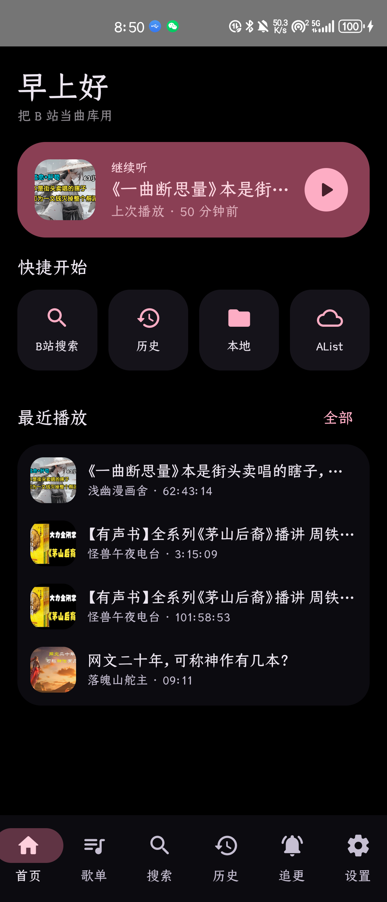
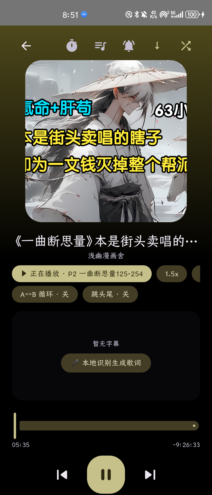
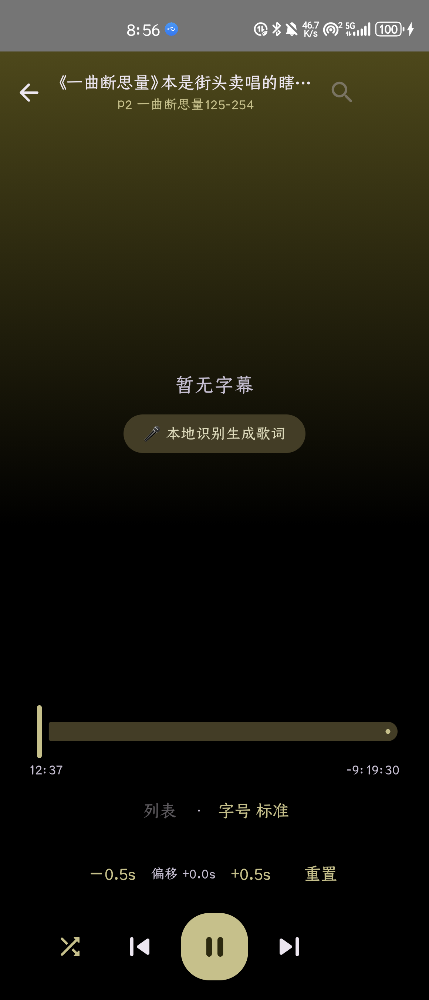
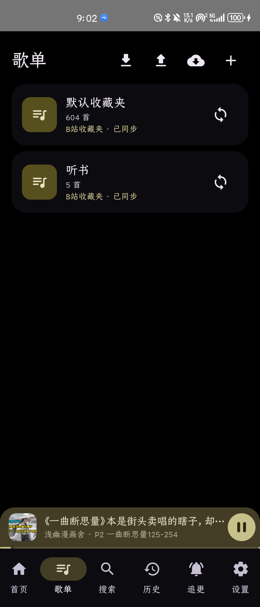
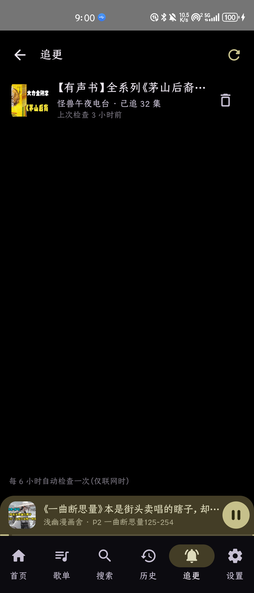
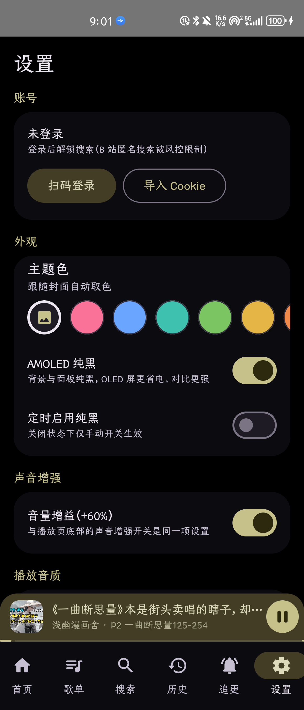

# galigalimusic

把 B 站当曲库用的原生 Android 音乐 / 听书播放器（Kotlin + Jetpack Compose + Media3）。

> 有声书长视频、分P 系列课、音乐 MV —— 收藏夹就是你的歌单。

## ✨ 核心价值

**只取音频，只为「听」而设计。** B 站藏着海量的音乐、有声书、广播剧、系列课和白噪音，但官方 App 只为「看」而设计。galigalimusic 把视频轻量化为音频，按纯收听产品的逻辑打磨每一个细节：

- 🎧 **只听不看** — 视频秒变音频流，通勤、睡前、做家务时屏幕可以一直黑着，通知栏/锁屏即可控制
- 📚 **有声书友好** — 分 P 独立进度自动续播、追更提醒、定时关闭（按分钟/按集数）、倍速，完全按听书软件的习惯来
- 🎤 **没字幕也有歌词** — whisper.cpp 本地语音识别，为没有人声字幕的视频生成整首歌词，还能逐句校正、随时恢复原始
- 🛡️ **稳到可以挂机** — B 站风控自动自愈（412 刷新重试）、断点续传下载、收藏夹绑定同步，长时间后台播放不中断

## 🚀 功能亮点

### 播放体验
- **分 P 体系**：选集面板、上下集切换、每个分 P 独立进度 —— 系列课、有声书按集续播
- **播放控制**：倍速（0.75–2.0x）、定时关闭（分钟/集数双模式）、AB 循环、跳过头尾、音量增益（+60%）
- **后台与音质**：Media3 MediaSession 后台播放 + 锁屏/通知控制；播放音质三档可选（高 192K / 中 132K / 省流 64K）

### 歌词体系（差异化核心）
- **四级来源自动分级**：B 站 AI 字幕 → LRCLIB 同步歌词 → **whisper.cpp 本地流式识别** → 外部 LRC，可手动切换
- **本地识别生成歌词**：没有人声字幕的视频，一键用 whisper.cpp 在机内生成整首歌词（模型/语言可选，不联网、不上传）
- **逐句校正**：改文字、调时间轴（±0.5s 微调 / 一键定位当前播放位置 / 上下句导航），保存为「已校正」来源，可随时恢复原始
- **歌词页**：滚动居中放大、整页歌词、时间偏移微调（±0.5s / 重置）

### 内容管理
- **歌单体系**：本地歌单 + B 站收藏夹一键导入/同步（全量分页拉取，绑定 mediaId 支持再次同步）
- **外部歌单导入**：m3u / JSON 备份 / 纯歌单名清单，按内容自动嗅探类型，BV 号正则提取 + 联网补全标题作者封面
- **追更提醒**：订阅后每 6 小时自动检查分 P 数，有新集数即通知（点击直接播放），追更页集中管理
- **账号体系**：扫码登录 / SESSDATA 导入兜底，Cookie 仅存本机私有目录，不参与任何上传

### 离线与备份
- **离线下载**：media3 DownloadManager，断点续传、失败原因提示、一键重试自动换新直链；下载即离线播放
- **本地音乐**：扫描手机本地音频（MediaStore），点击即用统一播放器播放
- **AList 网盘**：浏览 AList（WebDAV）目录并流播
- **WebDAV 云端备份**：歌单全量 JSON 备份，支持连接测试、立即备份、从云端恢复、每周自动备份

### 个性化
- **封面动态取色**（方案 B）：整套界面强调色随播放封面实时派生（按钮/开关/导航/容器同步）
- **主题色板**：8 个预设色 + 「跟随封面」自动档，点选即换，选择持久化
- **AMOLED 纯黑**：手动常开 + 定时启用（起止小时可调，支持跨零点如 22→6），OLED 屏更省电、对比更强

### 稳定自愈
- **B 站风控自愈**：OkHttp 拦截器捕获 HTTP 412 自动刷新 buvid 重试（防重入不会死循环）；接口体 `code=-412` 的搜索/取流同样自动包裹重试，匿名搜索被限时也有明确提示

## 📸 功能截图

<table>
  <tr>
    <td align="center">
      <br>
      <b>首页 · 打开即续播</b><br>
      <sub>「早上好」问候 + 继续听卡片，快捷进入搜索/历史/本地/AList，最近播放一屏总览</sub>
    </td>
    <td align="center">
      <br>
      <b>播放页 · 只听不看</b><br>
      <sub>封面动态取色、分 P 信息、倍速/AB 循环/跳头尾、定时/队列/追更/下载一屏可达</sub>
    </td>
  </tr>
  <tr>
    <td align="center">
      <br>
      <b>歌词页 · 没字幕也能识别</b><br>
      <sub>无人声字幕的视频，whisper.cpp 本地识别生成整首歌词；支持时间偏移微调</sub>
    </td>
    <td align="center">
      <br>
      <b>歌单 · 收藏夹即曲库</b><br>
      <sub>B 站收藏夹一键导入/再同步，本地歌单、备份导入导出、外部歌单导入集中管理</sub>
    </td>
  </tr>
  <tr>
    <td align="center">
      <br>
      <b>追更 · 更新不错过</b><br>
      <sub>订阅后每 6 小时自动检查新集数，通知点击直达播放，已追集数一目了然</sub>
    </td>
    <td align="center">
      <br>
      <b>主题 · 随心换色</b><br>
      <sub>8 个预设色 + 跟随封面自动取色，AMOLED 纯黑与定时开关，音量增益/音质同屏设置</sub>
    </td>
  </tr>
</table>

## 🎯 使用场景

| 场景 | 怎么用 |
|---|---|
| 🚇 **通勤路上** | 收藏夹就是歌单，后台播放 + 锁屏控制；提前离线缓存，地铁里没信号也能听 |
| 🛏 **睡前听书** | 定时关闭支持「按分钟/按集数」，倍速拖进度；追更有新集数推送通知 |
| 📖 **系列课 / 广播剧** | 分 P 独立进度自动续播，换手机用 WebDAV 备份恢复，进度歌单不丢 |
| 🎤 **无人声字幕的音乐视频** | whisper 本地识别生成歌词，逐句校正时间轴，听歌跟唱两不误 |
| 🧹 **做家务 / 跑步 / 开车** | 只听不看，音量增益补偿不同 UP 主的录音音量差异，长时间挂机风控自愈 |

## 技术栈

Kotlin · Jetpack Compose · Media3 (ExoPlayer + MediaSession + DownloadManager) · Room · OkHttp/Retrofit · WorkManager · whisper.cpp（JNI/CMake，arm64）

## 构建

```bash
# 需要 JDK 17 与 Android SDK（local.properties 指定 sdk.dir）
./gradlew :app:assembleProdRelease   # 正式签名包（需 keystore.properties）
./gradlew :app:assembleDevDebug      # 调试包
```

> `keystore/` 与 `keystore.properties` 不在仓库中：放入自己的签名文件，或改用 debug 签名构建。

## 目录速览

```
app/src/main/java/com/galigalimusic/
├── data/remote/      # B 站 WBI 签名 API、AList 配置
├── data/local/       # Room（历史 bvid+cid 复合键、歌单两表）
├── player/           # MusicService、Downloads（离线中枢）、MediaCache
├── whisper/          # whisper.cpp JNI、音频解码切片、模型下载
├── work/             # UpdateCheckWorker（追更）、BackupWorker（WebDAV 自动备份）
├── ui/screens/       # 播放/歌词/歌单/搜索/下载/本地/AList 等页面
└── viewmodel/        # PlayerViewModel（统一播放入口）等
```

## 声明

- 本项目为 B 站第三方客户端，使用非官方接口，仅供学习交流，请勿商用
- 请遵守 B 站用户协议，合理控制请求频率
- 登录态（Cookie）仅保存在本机应用私有目录，不参与任何上传

## License

MIT
